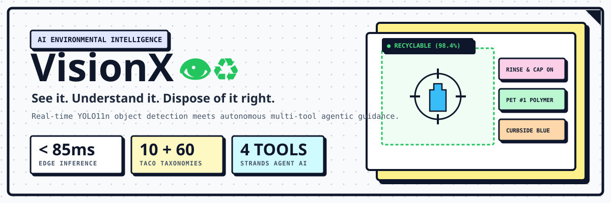
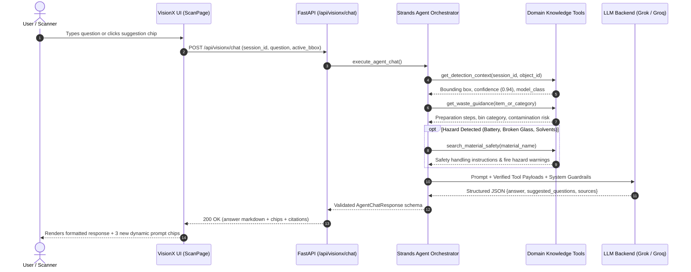
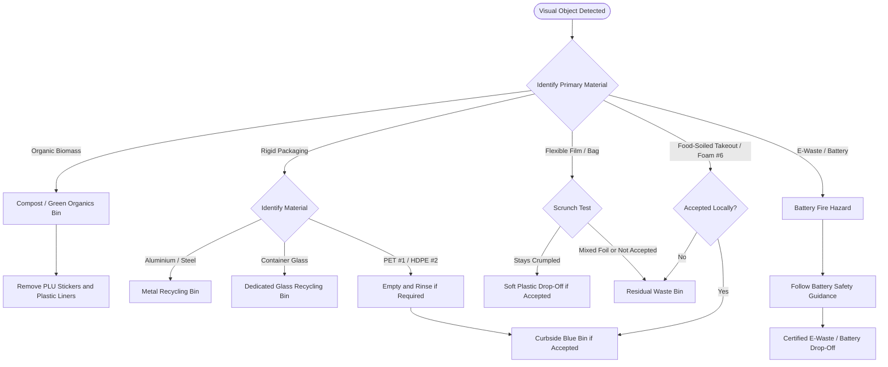

<div align="center">



---

[](LICENSE)
[](https://react.dev/)
[](https://www.typescriptlang.org/)
[](https://vitejs.dev/)
[](https://fastapi.tiangolo.com/)
[](https://github.com/ultralytics/ultralytics)
[](https://pytorch.org/)
[](https://render.com)

**VisionX** is a real-time computer vision and agentic artificial intelligence platform designed to eliminate municipal recycling contamination. By combining ultra-fast edge object detection (YOLO11n) with autonomous multi-tool conversational reasoning (AWS Strands Agents framework), VisionX bridges the gap between raw object detection and actionable environmental compliance.

[Explore Architecture](#-system-architecture) • [Live Scanner](#-scanner--interactive-demonstrations) • [API Reference](#-rest-api-reference) • [Quickstart](#-local-development-setup) • [Waste Taxonomies](#-supported-waste-taxonomies)

</div>

---

## 📑 Table of Contents

- [🌟 Why VisionX?](#-why-visionx)
- [⚖️ VisionX vs. Traditional Vision Classifiers](#️-visionx-vs-traditional-vision-classifiers)
- [🧩 System Architecture](#-system-architecture)
  - [1. End-to-End Inference Pipeline](#1-end-to-end-inference-pipeline)
  - [2. Multi-Tool Agent Orchestration](#2-multi-tool-agent-orchestration)
  - [3. Waste Sorting & Contamination Decision Tree](#3-waste-sorting--contamination-decision-tree)
- [📸 Scanner & Interactive Demonstrations](#-scanner--interactive-demonstrations)
- [🗂️ Supported Waste Taxonomies](#️-supported-waste-taxonomies)
- [🔌 REST API Reference](#-rest-api-reference)
- [🛠️ Tech Stack & Tooling](#️-tech-stack--tooling)
- [⚙️ Environment Variables](#️-environment-variables)
- [🚀 Local Development Setup](#-local-development-setup)
- [☁️ Cloud Deployment (Render Blueprint)](#️-cloud-deployment-render-blueprint)
- [📚 Scientific References & Citations](#-scientific-references--citations)
- [📄 License](#-license)

---

## 🌟 Why VisionX?

Over **25% of municipal recyclables are diverted directly into landfills** due to aspirational recycling ("wishcycling") and cross-contamination (liquids soaking dry paper, grease on unwashed plastics, and flexible films tangling sorting conveyor belts).

Traditional computer vision applications only answer: **"What object is this?"**
VisionX answers: **"What is it, how should it be cleaned and prepped, which local bin does it belong in, and what happens if you dispose of it incorrectly?"**

### Key Capabilities:

- ⚡ **Sub-85ms Real-Time Inference:** Fine-tuned YOLO11n weights with class-agnostic Non-Maximum Suppression (NMS) and containment deduplication.
- 🎯 **Tactile Retro Neo-Brutalist Interface:** Bold outlines, hard offset ink shadows, zero blurred glassmorphism, and responsive physical button physics.
- 📹 **Dual-Mode Scanner (`/scan`):** Zero-latency HTML5 canvas freeze-frame webcam streaming with front/rear camera switching, plus drag-and-drop photo upload.
- 🛡️ **Responsible Uncertainty Flagging:** Avoids reckless overconfidence by differentiating visually verified materials from unverified polymers (e.g. labeling clear plastic bottles as *"Likely PET #1 (Unverified Polymer)"*).
- 🤖 **Agentic Multi-Tool Assistance:** Integrated slide-over drawer powered by the AWS Strands Agents framework and LLM backends (xAI Grok / Groq Llama 3.3) equipped with 4 deterministic domain tools.

---

## ⚖️ VisionX vs. Traditional Vision Classifiers

| Feature | Generic Image Classifier | VisionX Waste Intelligence | Impact |
| :--- | :--- | :--- | :--- |
| **Output Type** | Raw string (e.g. `"bottle"`) | Full structured material profile + disposal routing | Direct user actionability |
| **Preparation Steps** | ❌ None | ✅ Itemized checklist (Rinse, Cap retention, Flatten) | Prevents compactor contamination |
| **Contamination Alerts** | ❌ None | ✅ Critical hazard warnings (grease, liquids, lithium) | Protects MRF equipment & paper bales |
| **Duplicate Filtering** | Basic IoU (frequently produces ghost boxes) | Custom maximum IoU + Box Containment Deduplication | Clean, single-winner object cards |
| **Material Verification** | False certainty (assumes 100% recyclable) | Explicit `material_verified: false` for unverified resins | Prevents wishcycling |
| **Follow-up Interaction** | Static non-interactive cards | Contextual conversational agent with clickable prompt chips | Instant user clarification |

---

## 🧩 System Architecture

VisionX couples a client-side React 19 application with a high-throughput FastAPI inference server and an autonomous agent reasoning layer.

### 1. End-to-End Inference Pipeline

```mermaid
---
config:
  layout: elk
  theme: base
---
flowchart LR
 subgraph Client["Client Layer (React 19 + TypeScript)"]
        B["HTML5 Canvas Capture & Client Validation"]
        A["User Input: Webcam Stream or File Dropzone"]
        C["Normalized Multipart Request"]
  end
 subgraph Backend["FastAPI Gateway (backend/server.py)"]
        D["Image Decoding & RGB Transformation"]
        E["YOLO11n Inference Engine - weights/best.pt"]
        F["Class-Agnostic NMS - IoU 0.35"]
        G["Containment & IoU Deduplication Algorithm"]
        H["Coordinate Normalization 0..1 Box Mapping"]
        I["Waste Knowledge Engine - waste_knowledge.py"]
  end
 subgraph AgenticLayer["Reasoning Layer (backend/agent/strands_agent.py)"]
        J["Enriched Detection Payload"]
        K["AWS Strands Agent Context Registry"]
        L["Multi-Tool Agent Orchestrator"]
        M["Structured JSON Response Generator"]
  end
 subgraph Display["Interactive UI (ScanPage.tsx)"]
        N["Bounding Box Overlays + Preparation Cards"]
        O["Dynamic Chat Assistant Drawer + Action Chips"]
  end
    A --> B
    B --> C
    C --> D
    D --> E
    E --> F
    F --> G
    G --> H
    H --> I
    I --> J
    J --> K
    K --> L
    L --> M
    M --> N
    N --> O
```



---

### 2. Multi-Tool Agent Orchestration

When users ask questions about detected objects, the **Strands Agent** leverages 4 specialized deterministic tools rather than hallucinating answers:



---

### 3. Waste Sorting & Contamination Decision Tree



---

## 📸 Scanner & Interactive Demonstrations

VisionX provides two operational modalities:

### 1. Dedicated Live Camera Scanner (`/scan`)
- **Webcam Interface:** Accessible on mobile or desktop via standard WebRTC streams.
- **Orientation Toggle:** Quick front/rear camera flip with mirrored selfie compensation.
- **Bounding Box Reticles:** Instant visual positioning of detected objects with high-contrast badge borders and confidence percentages.
- **Dynamic Assistant Drawer:** Slide-over assistant panel pre-loaded with context-aware prompt chips like:
  - *"Should I leave the plastic cap on or throw it away?"*
  - *"Why does VisionX mark this as unverified polymer?"*
  - *"What happens if this container is greasy?"*

### 2. Pre-Configured Benchmark Scenarios (Landing Page)
Three built-in environmental benchmarks illustrate edge-case handling:
1. **Plastic Beverage Bottle:** Highlights contamination hazards from residual liquids and explores modern MRF cap retention policies.
2. **Banana Peel:** Explains methane generation in anaerobic landfill environments and emphasizes removal of non-compostable PLU stickers.
3. **Takeout Container:** Demonstrates unverified polymer handling, resin stamp inspection (#1-#6), and the impact of grease contamination.

---

## 🗂️ Supported Waste Taxonomies

The VisionX core engine detects 10 primary municipal superclasses, mapped onto 60 TACO (Trash Annotations in Context) categories:

| YOLO Class | Display Name | Material Composition | Primary Disposal Bin | Material Verified? | Critical Contamination Warning |
| :--- | :--- | :--- | :--- | :---: | :--- |
| `PlasticBottle` | Plastic Beverage Bottle | PET (#1) | 🔵 Curbside Recyclables | ⚠️ False (Unverified) | Liquids leak onto dry paper bales during collection compactor transit. |
| `PlasticWrapper` | Flexible Film & Bag | LDPE (#4) / PP Film | 🏪 Supermarket Drop-Off | ⚠️ False (Unverified) | **Major sorting hazard:** Wraps around MRF disc screens and jams axles. |
| `PaperCardboard` | Paper & Cardboard Box | Cellulose Fiber | 🔵 Clean Paper Bin | ✅ True | Greasy pizza oil permanently destroys paper pulp slurry batches. |
| `MetalWaste` | Metal Can & Container | Aluminium / Tin Steel | 🔵 Dry Recyclables | ✅ True | Pressurized aerosol containers must be completely empty before disposal. |
| `GlassWaste` | Glass Bottle & Jar | Soda-Lime Glass | 🟢 Dedicated Glass Bin | ✅ True | Never mix with Pyrex or drinking cups; ceramic glass ruins melted cullet batches. |
| `DisposableContainer` | Takeout Food Box | Polystyrene (#6) / Mixed | ⚫ Residual / Landfill | ⚠️ False (Conditional) | Food grease cannot be separated from plastics during mechanical recycling. |
| `Clothing` | Textile & Fabric | Cotton / Polyester Blend | 👕 Charity / Textile Bank | ⚠️ False (Unverified) | **Textile tangler:** Wraps tightly around MRF conveyor belts and motor spindles. |
| `OrganicWaste` | Biomass & Food Waste | Biodegradable Organics | 🟤 Compost / Organics Bin | ✅ True | Plastic produce PLU stickers and synthetic bags ruin municipal compost. |
| `EWaste` | Electronic & Battery | Circuitry / Lithium-ion | 🔴 Authorized E-Waste Depot | ⚠️ False (Unverified) | **Critical fire hazard:** Crushed lithium-ion cells cause explosive compactor truck fires. |
| `Other` | Mixed Litter / Unknown | Composite Material | ⚫ Residual Waste | ⚠️ False (Uncertain) | Do not "wishcycle" unknown composites; visual inspection required. |

---

## 🔌 REST API Reference

The VisionX FastAPI server operates on port `8000` by default.

### Endpoint Overview

| Method | Endpoint | Description | Request Type | Response Format |
| :---: | :--- | :--- | :---: | :---: |
| `GET` | `/api/health` | Health check, device status (CUDA/CPU), loaded model | N/A | `application/json` |
| `GET` | `/api/knowledge-base` | Complete municipal waste knowledge base | N/A | `application/json` |
| `POST` | `/api/detect` | Runs YOLO inference + containment deduplication | `multipart/form-data` | `application/json` |
| `POST` | `/api/visionx/chat` | Contextual multi-tool Strands Agent conversational Q&A | `application/json` | `application/json` |

---

<details>
<summary><b>🔍 Expand: Detailed API Payloads and Sample Responses</b></summary>

### 1. `POST /api/detect`
**Query Parameters:**
- `conf` *(float, optional, default: 0.18)*: Minimum detection confidence threshold (range `0.05` - `1.0`).

**Request Payload:**
```http
POST /api/detect?conf=0.20 HTTP/1.1
Content-Type: multipart/form-data; boundary=----WebKitFormBoundary

------WebKitFormBoundary
Content-Disposition: form-data; name="file"; filename="sample_bottle.jpg"
Content-Type: image/jpeg

<binary image content>
------WebKitFormBoundary--
```

**Response Payload (`200 OK`):**
```json
{
  "success": true,
  "inference_time_ms": 68.4,
  "image_width": 1920,
  "image_height": 1080,
  "confidence_threshold": 0.2,
  "detections_count": 1,
  "detections": [
    {
      "id": "det-1",
      "model_class_name": "PlasticBottle",
      "display_name": "Plastic Beverage Bottle",
      "confidence": 0.942,
      "box": {
        "x": 0.224,
        "y": 0.151,
        "width": 0.452,
        "height": 0.689
      },
      "waste_category": "recyclable",
      "material": "Polyethylene Terephthalate (PET #1)",
      "material_verified": false,
      "disposal_method": "Recycle in curbside plastic recycling bin",
      "preparation_steps": [
        "Empty all liquid contents completely into a sink",
        "Give a quick rinse with clean water to remove sticky residues",
        "Crush the bottle flat to conserve collection and bin space",
        "Screw the plastic cap back on tightly before placing in the bin"
      ],
      "contamination_warning": "Leftover sugary liquids leak during compression in collection trucks, contaminating dry paper bundles.",
      "reusability": "Can be repurposed for storage or refilled if food-grade.",
      "environmental_impact": "Recycling 1 ton of PET plastic saves approx 3.8 barrels of crude oil."
    }
  ]
}
```

---

### 2. `POST /api/visionx/chat`
**Request Payload:**
```json
{
  "session_id": "session-live-001",
  "user_question": "Can I leave the plastic cap on this bottle?",
  "selected_object": {
    "display_name": "Plastic Beverage Bottle",
    "waste_category": "recyclable",
    "material": "Polyethylene Terephthalate (PET #1)"
  },
  "history": [],
  "locality": "General Municipal"
}
```

**Response Payload (`200 OK`):**
```json
{
  "success": true,
  "answer": "Yes! In most modern municipal recovery facilities (MRFs), leaving the cap **firmly screwed on** the bottle is the standard recommendation. It prevents small caps from slipping through sorting screens into landfill crushers.",
  "suggested_questions": [
    "Does this bottle need to be completely dry?",
    "What should I do with the paper label?",
    "Where is the nearest soft plastic drop-off?"
  ],
  "sources": [
    "Association of Plastic Recyclers (APR) Design Guide",
    "EPA Municipal Solid Waste Protocol"
  ],
  "needs_clarification": false,
  "uncertainty_note": null
}
```

</details>

---

## 🛠️ Tech Stack & Tooling

```
VisionX
├── Frontend  ──────  React 19 + TypeScript + Vite 8 + Lucide Icons
├── Backend   ──────  FastAPI + Uvicorn + Python 3.11 + Pydantic v2
├── Vision ML ──────  YOLO11n + Ultralytics + PyTorch (CPU/CUDA) + Pillow
├── Agent AI  ──────  AWS Strands Agents SDK + xAI Grok / Groq Llama 3.3
└── Deploy    ──────  Render Cloud Blueprint (IaC) + Global CDN Static Host
```

| Layer | Technology | Version | Purpose |
| :--- | :--- | :--- | :--- |
| **Frontend Framework** | React | `^19.2.8` | High-performance reactive UI and virtual DOM |
| **Language (Web)** | TypeScript | `~6.0.2` | Strict end-to-end type safety |
| **Build Tool** | Vite | `^8.3.0` | Sub-second HMR and optimized production bundles |
| **Icons & Design** | Lucide React | `^1.54.0` | Minimalist tactile icons |
| **Linter** | Oxlint | `^1.81.0` | Next-generation Rust-based code linter |
| **Backend Framework** | FastAPI | `^0.115.0` | High-throughput asynchronous ASGI web server |
| **Computer Vision** | Ultralytics / YOLO | `^8.3.0` | Real-time object detection model serving |
| **Deep Learning** | PyTorch | `^2.0.0` | Tensor computation on CPU and CUDA GPUs |
| **Image Processing** | Pillow (PIL) | `^10.0.0` | In-memory RGB conversion & coordinate mapping |
| **Agent Framework** | Strands Agents | `^1.59.0` | Autonomous tool-calling and context orchestration |
| **LLM Inference** | Grok / Groq | API | Grounded conversational reasoning |

---

## ⚙️ Environment Variables

Create a `.env` file in the project root by copying `.env.example`:

```bash
cp .env.example .env
```

| Variable | Required? | Default | Description |
| :--- | :---: | :--- | :--- |
| `GROK_API` | Optional* | None | API key for Grok (xAI) or Groq Llama-3.3 LLM agent. Starts with `xai-` or `gsk_`. |
| `VITE_API_URL` | Optional | `http://127.0.0.1:8000` | Points the frontend to the backend REST API endpoint. |
| `PYTHON_VERSION` | Optional | `3.11.9` | Pinned Python runtime for cloud deployment. |

*\*Note: If no LLM key is configured, the agent safely falls back to internal deterministic knowledge base retrieval without breaking.*

---

## 🚀 Local Development Setup

### Prerequisites
- **Node.js** `>= 18.0.0`
- **Python** `>= 3.10`
- **Git**

### 1. Clone the Repository
```bash
git clone https://github.com/ITS-LLM-2026/VisionX.git
cd VisionX
```

### 2. Frontend Setup
```bash
# Install frontend dependencies
npm install

# Start Vite development server
npm run dev
```
Open **[http://localhost:5173](http://localhost:5173)** in your browser.

### 3. Backend Setup
In a separate terminal window:
```bash
# Optional: Create and activate a virtual environment
python -m venv venv

# Windows:
venv\Scripts\activate
# Linux/macOS:
source venv/bin/activate

# Install optimized backend dependencies
pip install -r requirements.txt

# Start the FastAPI server
python backend/server.py
```
The API server will run at **[http://127.0.0.1:8000](http://127.0.0.1:8000)**. Interactive Swagger docs are available at **[http://127.0.0.1:8000/docs](http://127.0.0.1:8000/docs)**.

### 4. Running Automated Tests
```bash
python backend/test_api_integration.py
```

<details>
<summary><b>🧪 Expected Test Suite Output</b></summary>

```text
=== Running VisionX API Integration Tests ===
[1/4] Testing GET /api/health ...
      -> Health check passed! Supported classes: 10
[2/4] Testing GET /api/knowledge-base ...
      -> Knowledge base endpoint passed! Classes count: 10
[3/4] Testing POST /api/detect with valid image ...
      -> Detection endpoint passed! Inference time: 54.12ms, Detections: 1
[4/4] Testing POST /api/detect with invalid file ...
      -> Rejected invalid file as expected (400 Bad Request)
=== ALL INTEGRATION TESTS PASSED SUCCESSFULLY! ===
```

</details>

---

## ☁️ Cloud Deployment (Render Blueprint)

VisionX includes an automated Infrastructure-as-Code deployment manifest (`render.yaml`).

### Deploy via Render Blueprint:
1. Fork or push this repository to GitHub.
2. Sign in to [Render](https://render.com).
3. Navigate to **Blueprints** and click **New Blueprint Instance**.
4. Select your `VisionX` repository.
5. Render will automatically provision two services:
   - **`visionx-api`**: Python 3.11 Web Service running the FastAPI inference backend.
   - **`visionx`**: Static Site hosting the React 19 SPA with single-page URL rewrites.
6. Set the `GROK_API` environment variable under `visionx-api` settings if conversational agent reasoning is required.

---

## 📚 Scientific References & Citations

VisionX's taxonomy and contamination protocols are built on verified open research:

1. **TACO Dataset:**  
   Proença, P. F., & Simões, P. (2020). *TACO: Trash Annotations in Context for Litter Detection*. [arXiv:2003.06975](https://arxiv.org/abs/2003.06975).
2. **EPA Municipal Solid Waste Guidelines:**  
   United States Environmental Protection Agency. *Advancing Sustainable Materials Management: Fact Sheet & Recycling Measurement*. [EPA.gov](https://www.epa.gov/recycle).
3. **Association of Plastic Recyclers (APR):**  
   *The APR Design® Guide for Plastics Recyclability*. [PlasticsRecycling.org](https://plasticsrecycling.org).
4. **AWS Strands Agents SDK:**  
   Open-source autonomous Python agent framework for multi-tool execution and structured LLM outputs.

---

## 📄 License

This project is licensed under the **MIT License**. See the [LICENSE](LICENSE) file for full details.

---

<div align="center">
  <sub>Built with ❤️ by the VisionX Open Source Team. Let's make zero-contamination recycling a reality.</sub>
</div>
